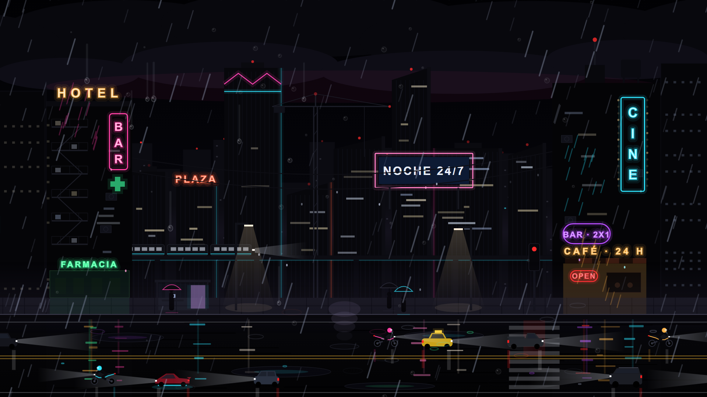

# lluvia-neon

[English](README.md) · **Español**

Tema para la pestaña **Code** de la app de escritorio de Claude: detrás de la conversación, una ciudad actual de noche bajo una tormenta, con rayos, letreros de neón, metro elevado, tránsito, calle mojada con reflejos y gotas sobre el vidrio. La app entera toma la paleta de la escena (grises violeta de noche con acentos rosa, cian y violeta) y los paneles se oscurecen como vidrio ahumado para que el texto se siga leyendo.



## Requisitos

- La pestaña Code de la app de escritorio de Claude. La terminal no dibuja fondos.
- Una versión de Claude Code que soporte escenas y shaders de tema (2.1.328 o más nueva).
- Una cuenta que permita mods.

## Instalación

Desde la terminal, en el prompt de una sesión de Claude Code:

```
/plugin install lluvia-neon --marketplace JaySC14/lluvia-neon
```

Responder `y` para agregar el marketplace y elegir el alcance (usuario).

Desde una shell (necesita `git`):

```bash
claude plugin install lluvia-neon --marketplace JaySC14/lluvia-neon
```

En la app de escritorio: **+** junto al cuadro del prompt → **Plugins** → **Add marketplace** con `JaySC14/lluvia-neon` → **Add plugin**.

Después de instalarlo, abrí una sesión nueva en la pestaña Code: el tema se aplica al iniciar la sesión.

## Uso

| Comando | Qué hace |
| --- | --- |
| `/lluvia` | Prende la tormenta (o la vuelve a arrancar si se quedó quieta) |
| `/lluvia apagar` | Quita el fondo y los colores; sigue apagado en las sesiones siguientes hasta que uses `/lluvia` |

Si el fondo no aparece, `/lluvia` dice por qué.

## Cómo funciona

- `hooks/escena.ts` arma el SVG con funciones puras y un generador con semilla fija. El fondo se dibuja en un frame sin scripts, así que las animaciones se escriben como SMIL y `aCss` las entrega como CSS (`@keyframes` y clases compartidas).
- En la app de escritorio, la lluvia la dibuja la placa de video con `hooks/lluvia-gpu.ts` (un `Shader`), encima de la escena sin lluvia y con las nubes y la niebla quietas. Así cada cuadro solo redibuja lo chico que se mueve (autos, letreros, metro). Si la app no puede correr el shader, muestra la escena sola. En el celular la lluvia va en el SVG.
- Ninguna animación recalcula formas (todo se mueve, escala o cambia de opacidad) y ninguna luz grande cambia de golpe: la app frena una escena que destella. Hay pruebas que lo controlan.
- La app pausa el fondo cuando no se ve o cuando está ocupada (por ejemplo, con un mensaje largo en la caja de texto). Para recuperarlo, `hooks/register.tsx` lo vuelve a dibujar al abrir la sesión, al volver a la ventana, al mandar un mensaje, cuando dejás de escribir un mensaje largo y cada 10 minutos.
- Los colores salen de `makeColors` (`hooks/make-colors.js`, copiado tal cual del kit de mods de Claude Code).
- La escena se adapta a cualquier ventana sin recortarse: se ve entera y apoyada abajo; en pantallas anchas siguen los edificios y la calle a los costados, y en ventanas angostas el cielo ocupa lo que sobra arriba.

## Desarrollo

```bash
claude plugin validate .
claude plugin test .
```

Para probarlo sin instalar, abrí Claude Code con `claude --plugin-dir <carpeta del mod>`.

## Licencia

MIT, ver [LICENSE](LICENSE).
