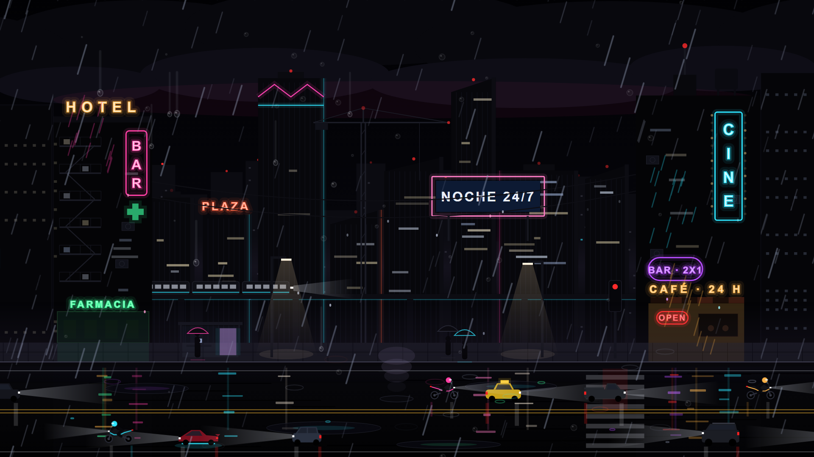

# lluvia-neon

**English** · [Español](README.es.md)

A theme for the **Code** tab of the Claude desktop app: behind the conversation, a modern city at night in a storm, with lightning, neon signs, an elevated train, traffic, a wet street full of reflections and drops on the glass. The whole app takes the scene's palette (violet night grays with pink, cyan and purple accents) and the panels darken like smoked glass so text stays readable.



## Requirements

- The Code tab of the Claude desktop app. The terminal does not draw backdrops.
- A Claude Code version that supports theme scenes and shaders (2.1.328 or newer).
- An account that allows mods.

## Install

From the prompt of a Claude Code session:

```
/plugin install lluvia-neon --marketplace JaySC14/lluvia-neon
```

Answer `y` to add the marketplace and pick the scope (user).

From a shell (needs `git`):

```bash
claude plugin install lluvia-neon --marketplace JaySC14/lluvia-neon
```

In the desktop app: **+** next to the prompt box → **Plugins** → **Add marketplace** with `JaySC14/lluvia-neon` → **Add plugin**.

Then open a new session in the Code tab: the theme applies when the session starts.

## Usage

| Command | What it does |
| --- | --- |
| `/lluvia` | Turns the storm on (or restarts it if it got stuck) |
| `/lluvia apagar` | Removes the backdrop and colors; stays off in later sessions until you use `/lluvia` |

If the backdrop does not show, `/lluvia` says why.

## How it works

- `hooks/escena.ts` builds the SVG from pure functions and a fixed-seed generator. The backdrop is drawn in a frame without scripts, so animation is written as SMIL and `aCss` delivers it as CSS (`@keyframes` and shared classes).
- In the desktop app, the rain is drawn on the GPU by `hooks/lluvia-gpu.ts` (a `Shader`), over the scene without rain and with clouds and fog held still. Each frame then only redraws the small things that move (cars, signs, train). If the app can't run the shader, it shows the scene alone. On mobile the rain stays in the SVG.
- No animation recomputes shapes (everything moves, scales or fades) and no large light changes at once: the app holds still a scene that flashes. Tests check both.
- The app pauses the backdrop when it's hidden or busy (for example, with a long message in the prompt box). To recover, `hooks/register.tsx` redraws it when the session opens, when the window comes back, on each message, when you stop typing a long message, and every 10 minutes.
- Colors come from `makeColors` (`hooks/make-colors.js`, copied unchanged from the Claude Code mod kit).
- The scene fits any window without cropping: it always shows whole, resting on the bottom edge; on wide screens buildings and street continue at the sides, and in narrow windows the sky fills the space above.

## Development

```bash
claude plugin validate .
claude plugin test .
```

To try it without installing, start Claude Code with `claude --plugin-dir <mod folder>`.

## License

MIT, see [LICENSE](LICENSE).
